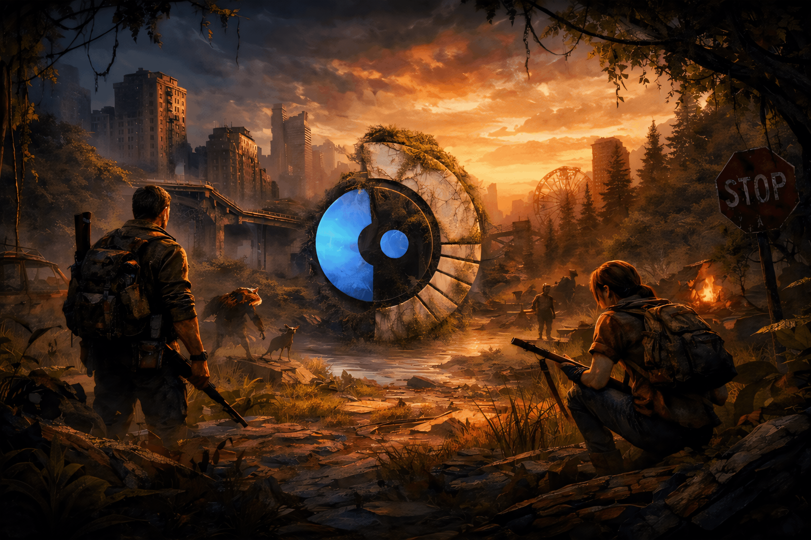

# SteamOS Wallpapers for SteamOS & SteamDeck

Almost all my devices run SteamOS or one of its variants, including my Steam Deck. The first thing I change is the Desktop Mode wallpaper, so I made a few that reflect the OS, the device, and gaming.

The Wallpapers are made with GenAI, and if i am bored I might create more. Contact me if you have themes or ideas to create.

## Preview

| 01 | 02 | 03 |
|----|----|----|
|  |  |  |

## Download

The images in this repo are previews only. The full 4K versions are in the ⬇ [Releases](https://github.com/extremesh/steamOS_wp/releases) section.

## Links

- Blog post: [Free Wallpapers for SteamOS & SteamDeck in 4K](https://meshra.net/free-wallpapers-for-steamos-steamdeck-in-4k/)
- Want a wallpaper idea or a specific game theme? Tell me on [Discord](https://meshra.net/contact)

---

Made & maintained by [eXtreMesh](https://ramesh.my)
